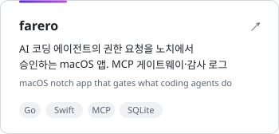
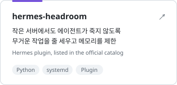
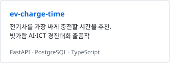
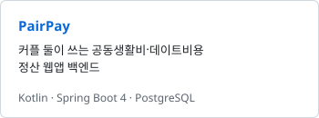
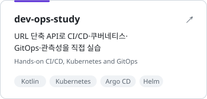
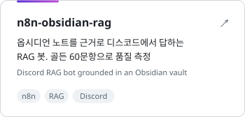
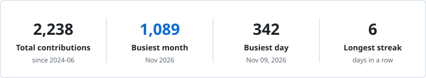
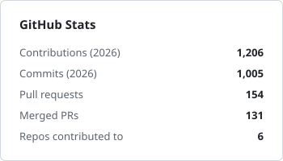
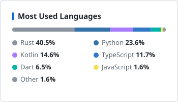

<picture><source media="(prefers-color-scheme: dark)" srcset="assets/header-dark.svg"></picture>

대덕소프트웨어마이스터고등학교에 다니는 백엔드 개발자입니다.

Backend developer at Daedeok Software Meister High School. I build APIs, then deploy and run them myself.
I fix the cause rather than throw resources at a problem, and I only ship code I can explain, even when an AI helped write it.

<picture>
  <source media="(prefers-color-scheme: dark)" srcset="https://skillicons.dev/icons?i=kotlin,java,spring,python,fastapi,ts,postgres,mysql,redis,docker,kubernetes,terraform,githubactions&perline=13&theme=dark">
  
</picture>

### Projects

<a href="https://github.com/farero-dev/farero-dev.github.io"><picture><source media="(prefers-color-scheme: dark)" srcset="assets/project-farero-dark.svg"></picture></a>
<a href="https://github.com/seongj-un/hermes-headroom"><picture><source media="(prefers-color-scheme: dark)" srcset="assets/project-hermes-headroom-dark.svg"></picture></a>
 
<a href="https://github.com/seongj-un/ev-charge-time"><picture><source media="(prefers-color-scheme: dark)" srcset="assets/project-ev-charge-time-dark.svg"></picture></a>
<a href="https://github.com/seongj-un/duri"><picture><source media="(prefers-color-scheme: dark)" srcset="assets/project-pairpay-dark.svg"></picture></a>
 
<a href="https://github.com/seongj-un/dev-ops-study"><picture><source media="(prefers-color-scheme: dark)" srcset="assets/project-dev-ops-study-dark.svg"></picture></a>
<a href="https://github.com/seongj-un/n8n-obsidian-rag"><picture><source media="(prefers-color-scheme: dark)" srcset="assets/project-n8n-obsidian-rag-dark.svg"></picture></a>

### Open Source

- **[NousResearch/hermes-agent](https://github.com/NousResearch/hermes-agent)** [#149222](https://github.com/NousResearch/hermes-agent/pull/149222) — 직접 만든 [headroom](https://github.com/seongj-un/hermes-headroom) 플러그인을 공식 플러그인 카탈로그에 등록
   Added my headroom plugin, which keeps the agent alive on small machines, to the official plugin catalog
- **[Louis-CFM/coucou](https://github.com/Louis-CFM/coucou)** [#872](https://github.com/Louis-CFM/coucou/pull/872) — accept나 파이프 연결이 한 번 실패해도 훅 서버가 계속 대기하도록 수정
   Kept the hook server listening after a failed accept or pipe connect

[전체 PR 보기 · All pull requests](https://github.com/pulls?q=is%3Apr+author%3Aseongj-un+-user%3Aseongj-un+-org%3Ateam-xquare)

### GitHub Stats

<picture><source media="(prefers-color-scheme: dark)" srcset="assets/highlights-dark.svg"></picture>
 
<picture><source media="(prefers-color-scheme: dark)" srcset="assets/stats-dark.svg"></picture>
<picture><source media="(prefers-color-scheme: dark)" srcset="assets/langs-dark.svg"></picture>

