<picture>
  <source media="(prefers-color-scheme: dark)" srcset="assets/banner-dark.svg">
  
</picture>

 

대덕소프트웨어마이스터고등학교에 다니는 백엔드 개발자입니다.
Kotlin·Spring Boot로 API를 만들고, 직접 배포하고 운영하는 일까지 맡는 것을 좋아합니다.
문제를 자원으로 덮기보다 원인부터 다시 정의하고, AI와 함께 쓴 코드도 직접 설명할 수 있을 때까지 확인합니다.

> Backend developer and student at Daedeok Software Meister High School.
> I build APIs with Kotlin and Spring Boot, then deploy and run them myself.
> I try to fix the cause rather than throw resources at a problem, and I only ship code I can explain, even when an AI helped write it.

 

### Tech Stack

| Area | Stack |
|:--|:--|
| **Language** |     |
| **Backend** |   |
| **Database** |    |
| **Infra & DevOps** |      |

 

### Open Source

| Repository | Contribution |
|:--|:--|
| **[NousResearch/hermes-agent](https://github.com/NousResearch/hermes-agent)**  | 직접 만든 [headroom](https://github.com/seongj-un/hermes-headroom) 플러그인을 공식 플러그인 카탈로그에 등록 [#149222](https://github.com/NousResearch/hermes-agent/pull/149222) Added my headroom plugin, which keeps the agent alive on small machines, to the official plugin catalog |
| **[Louis-CFM/coucou](https://github.com/Louis-CFM/coucou)**  | accept나 파이프 연결이 한 번 실패해도 훅 서버가 멈추지 않고 계속 대기하도록 수정 [#872](https://github.com/Louis-CFM/coucou/pull/872) Kept the hook server listening after a failed accept or pipe connect |

[전체 PR 보기 · All pull requests](https://github.com/pulls?q=is%3Apr+author%3Aseongj-un+-user%3Aseongj-un+-org%3Ateam-xquare)

 

### GitHub Stats

<picture>
  <source media="(prefers-color-scheme: dark)" srcset="assets/highlights-dark.svg">
  
</picture>
 
<picture>
  <source media="(prefers-color-scheme: dark)" srcset="assets/stats-dark.svg">
  
</picture>
<picture>
  <source media="(prefers-color-scheme: dark)" srcset="assets/langs-dark.svg">
  
</picture>
 
매일 06:00 KST에 GitHub Actions로 갱신 · Updated daily by GitHub Actions

